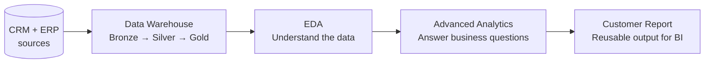

# SQL Data Analytics — EDA & Advanced Analytics on a Star Schema


The analytics layer of an end-to-end SQL project. After building a **[Medallion data warehouse](https://github.com/OssFad/SQL-Data-Warehouse-Project)**, this repository uses its Gold-layer star schema to answer business questions with SQL alone: first by **exploring** the data (EDA), then by applying **advanced analytical patterns** such as trends, running totals, YoY performance, part-to-whole contribution and customer segmentation.

> **Business questions this project answers**
> - How big is the business: revenue, orders, customers, products?
> - Which countries, categories and products drive revenue, and which ones lag behind?
> - How are sales trending month over month and year over year?
> - Which customers are VIP, Regular or New, and how much is each segment worth?

---

## Table of Contents

1. [Project Context](#project-context)
2. [Data Model](#data-model)
3. [Analytical Approach](#analytical-approach)
4. [Part 1 — Exploratory Data Analysis](#part-1--exploratory-data-analysis)
5. [Part 2 — Advanced Analytics](#part-2--advanced-analytics)
6. [Customer Report](#customer-report)
7. [SQL Techniques Demonstrated](#sql-techniques-demonstrated)
8. [Getting Started](#getting-started)
9. [Repository Structure](#repository-structure)
10. [Roadmap](#roadmap)
11. [Author](#author)

---

## Project Context

This is part two of a two-project series:

| # | Project | Role in the pipeline |
|---|---|---|
| 1 | [SQL Data Warehouse](https://github.com/OssFad/SQL-Data-Warehouse-Project) | Ingests CRM + ERP data, cleans it, and models it into a star schema (Bronze → Silver → Gold) |
| 2 | **SQL Data Analytics** *(this repo)* | Explores the Gold layer and turns it into business insights and reusable reports |



---

## Data Model

All queries run against the Gold layer of the warehouse:

| Object | Type | Grain | Key fields used in this project |
|---|---|---|---|
| `gold.fact_sales` | Fact | One row per order line | `order_number`, `order_date`, `sale_amount`, `quantity`, `price` |
| `gold.dim_customers` | Dimension | One row per customer | `customer_key`, `country`, `gender`, `marital_status`, `birthate` |
| `gold.dim_products` | Dimension | One row per active product | `product_key`, `category`, `subcategory`, `product_line`, `product_cost` |

---

## Analytical Approach

The work follows two structured frameworks, from understanding the data to extracting insight:

| EDA framework | Advanced analytics framework |
|---|---|
|  |  |

---

## Part 1 — Exploratory Data Analysis

Scripts: [`Scripts/EDA/`](Scripts/EDA)

| Step | Goal | Example questions |
|---|---|---|
| **1. Database exploration** | Understand what exists | Which tables and columns are available? (`INFORMATION_SCHEMA`) |
| **2. Dimension exploration** | Understand the categorical values | Which countries, genders and marital statuses appear? What is the category → subcategory → product hierarchy? |
| **3. Date exploration** | Understand time coverage | What is the first and last order date? How old are the youngest and oldest customers? How many days from order to shipment? |
| **4. Measure exploration** | Size the business | Total sales, quantity, average price, orders, products and customers, combined into **one KPI summary report** with `UNION ALL` |
| **5. Magnitude analysis** | Compare measures across dimensions | Customers by country and gender, revenue by category, items sold by country |
| **6. Ranking analysis** | Find the best and worst performers | Top 5 and bottom 5 products by revenue, top 10 customers, customers with the fewest orders |

Example: business KPI summary in a single result set.

```sql
SELECT 'total_sales'     AS measure_name, SUM(sale_amount)            AS measure_value FROM gold.fact_sales
UNION ALL
SELECT 'total_orders',                    COUNT(DISTINCT order_number)                  FROM gold.fact_sales
UNION ALL
SELECT 'total_customers_place_orders',    COUNT(DISTINCT customer_key)                  FROM gold.fact_sales;
```

---

## Part 2 — Advanced Analytics

Scripts: [`Scripts/Advanced Data Analytics/`](Scripts/Advanced%20Data%20Analytics)

| Analysis | Business question | Technique |
|---|---|---|
| **Change over time** | How do revenue, quantity, customers and products evolve by year and month? | `YEAR()`, `MONTH()`, `DATETRUNC()`, `GROUP BY` |
| **Cumulative analysis** | Is the business growing? What is the running total of sales within each year? | `SUM() OVER (PARTITION BY … ORDER BY …)`, moving average with a `ROWS BETWEEN` frame |
| **Performance analysis** | Is each product above or below its own average? How did it do vs. last year? | `AVG() OVER (PARTITION BY)`, `LAG()`, `CASE` flags |
| **Part-to-whole** | Which categories contribute most to total revenue? | `SUM() OVER ()` for the grand total, percentage of total |
| **Segmentation** | How are products spread across cost bands? How many customers are VIP, Regular or New? | `CASE` bucketing, CTEs, `DATEDIFF()` for customer lifespan |

Example: a running total of sales that restarts every year.

```sql
WITH monthly_sales AS (
    SELECT DATETRUNC(month, order_date) AS order_month,
           SUM(sale_amount)             AS total_sales
    FROM gold.fact_sales
    WHERE order_date IS NOT NULL
    GROUP BY DATETRUNC(month, order_date)
)
SELECT order_month,
       total_sales,
       SUM(total_sales) OVER (PARTITION BY YEAR(order_month) ORDER BY order_month) AS running_sales
FROM monthly_sales;
```

**Customer segmentation rules**

| Segment | Rule |
|---|---|
| **VIP** | At least 12 months of purchase history **and** total spend > €5,000 |
| **Regular** | At least 12 months of purchase history **and** total spend ≤ €5,000 |
| **New** | Less than 12 months of purchase history |

---

## Customer Report

Script: [`Customer Report dwl.sql`](Scripts/Advanced%20Data%20Analytics/Customer%20Report%20dwl.sql)

The final deliverable brings the analyses together into **one row per customer**, ready to feed a BI tool:

| Block | Fields |
|---|---|
| **Identity** | Customer key, full name, age, age group (Under 20 · 20–29 · 30–39 · 40–49 · 50+) |
| **Segment** | VIP / Regular / New |
| **Activity** | Total orders, total sales, total quantity, distinct products, first-to-last-order lifespan (months) |
| **KPIs** | Recency (months since last order), average order value, average monthly spend |

The query is built in three CTE stages: **base query** (join fact and dimensions) → **customer aggregation** → **segmentation and KPIs**. This keeps each step readable and easy to test on its own.

---

## SQL Techniques Demonstrated

| Category | Techniques |
|---|---|
| Aggregation | `SUM`, `AVG`, `COUNT(DISTINCT …)`, `GROUP BY` across multiple dimensions |
| Window functions | `SUM() OVER`, `AVG() OVER`, `RANK()`, `LAG()`, `PARTITION BY`, `ROWS BETWEEN` frames |
| Query structure | Multi-stage CTEs, subqueries, `UNION ALL` reports |
| Date logic | `DATETRUNC`, `DATEDIFF`, `YEAR`, `MONTH`, `GETDATE()` |
| Business logic | `CASE` segmentation, age banding, percentage of total, YoY comparison |
| Metadata | `INFORMATION_SCHEMA.TABLES` / `COLUMNS` for database discovery |

---

## Getting Started

### Prerequisites
- **SQL Server** 2022+ (needed for `DATETRUNC`) — Express or Developer edition is enough
- **SSMS** or Azure Data Studio
- The `DWH` database built from the **[SQL Data Warehouse](https://github.com/OssFad/SQL-Data-Warehouse-Project)** project, with the Gold views created

### Run

```bash
git clone https://github.com/OssFad/SQL-Data-Analytics-Project.git
```

1. Connect to the `DWH` database.
2. Run the EDA scripts in [`Scripts/EDA/`](Scripts/EDA): dimensions and dates first, then measures.
3. Run the scripts in [`Scripts/Advanced Data Analytics/`](Scripts/Advanced%20Data%20Analytics) in any order.

Every script is **read-only** (`SELECT` statements only). Nothing in the warehouse is changed.

---

## Repository Structure

```
SQL-Data-Analytics-Project/
├── Docs/
│   ├── EDA Process.png                         # EDA framework
│   └── Advance DA Process.png                  # Advanced analytics framework
├── Scripts/
│   ├── EDA/
│   │   ├── Dimensions and Date Exploration dwh.sql
│   │   └── Measures Exploration dwh.sql        # Measures, magnitude, ranking
│   └── Advanced Data Analytics/
│       ├── Change OverTime Analysis dwh.sql
│       ├── Cumulative Analysis dwh.sql
│       ├── Performance Analysis dwh.sql
│       ├── Part-to-Whole Proptional analysis dwh.sql
│       ├── Segmentation analysis dwh.sql
│       └── Customer Report dwl.sql
├── LICENSE
└── README.md
```

---

## Roadmap

- [ ] Save the customer report as a view (`gold.report_customers`) so BI tools can query it directly
- [ ] Build a matching **product report** (product segments, recency, average order revenue, monthly revenue)
- [ ] Connect Power BI to the reports and publish an executive dashboard
- [ ] Add a short **Key Insights** section with the main findings and charts
- [ ] Parameterize the segmentation thresholds (12 months, €5,000) instead of hard-coding them

---

## Author

**Ossama Fadloullah** — Data Analyst / Data Scientist · Morocco
SQL · Python · Power BI · Analytics Engineering

[LinkedIn](https://www.linkedin.com/in/your-profile) · [GitHub](https://github.com/OssFad)

---

## License

This project is licensed under the [MIT License](LICENSE).
